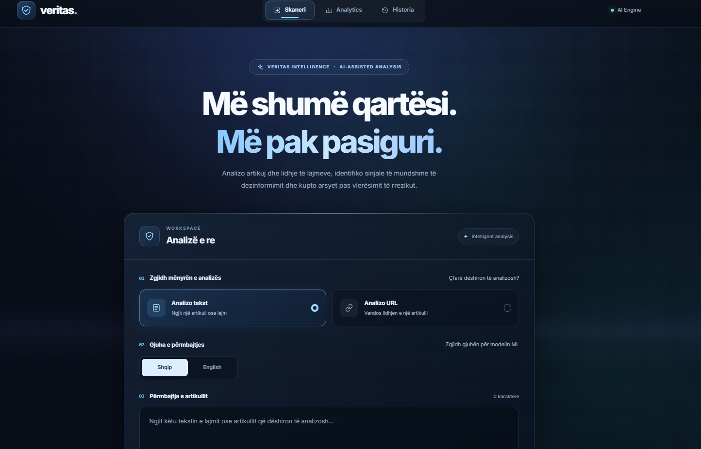
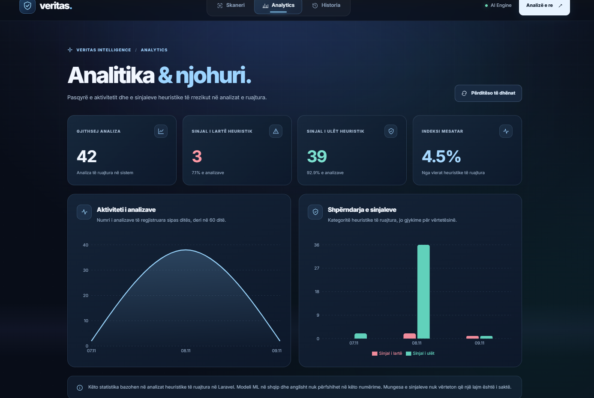
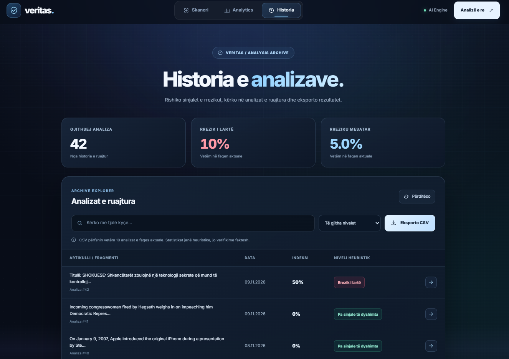
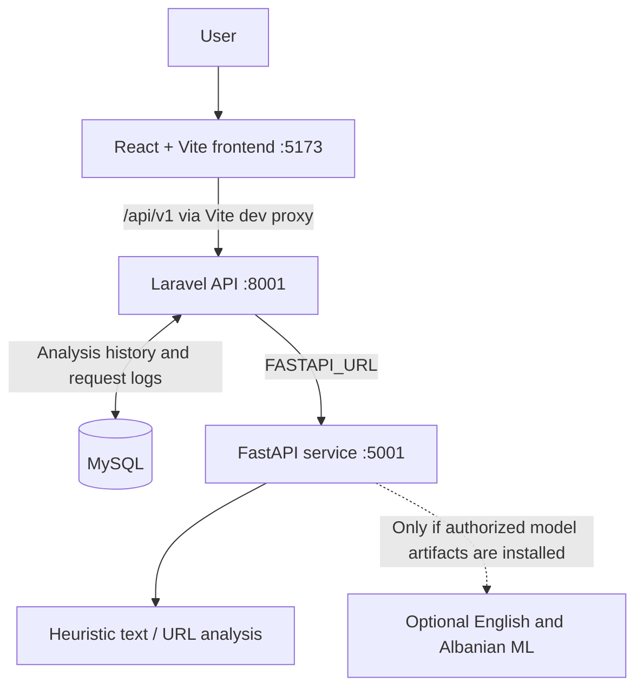

<div align="center">
  <h1>Veritas AI</h1>
  <h3>AI-assisted news analysis, with transparent risk signals</h3>
  <p><strong>A bilingual university software project built with React, Laravel, FastAPI and MySQL.</strong></p>
  <p><code>React 19</code> · <code>Vite 8</code> · <code>Laravel 13</code> · <code>FastAPI</code> · <code>Python</code> · <code>MySQL</code> · <code>scikit-learn</code></p>
  <p><strong>Text &amp; URL analysis</strong> · <strong>English &amp; Albanian</strong> · <strong>Analysis history</strong> · <strong>Analytics dashboard</strong></p>
</div>

---

> [!IMPORTANT]
> **Veritas AI is a research and educational prototype, not a fact-checking authority.** Its heuristic scores highlight implemented risk signals; optional machine-learning labels are statistical predictions. Neither a low-risk score nor a `REAL` prediction establishes factual truth. Always verify important claims with independent evidence and primary sources.

## Overview

Veritas AI helps users examine news articles through a clear, interactive workflow. A user can paste text or provide a news article URL, receive a structured heuristic assessment, explore an explanation of the observed signals and revisit stored analyses through History and Analytics.

The project connects a modern React frontend to a Laravel API, a Python analysis service and MySQL storage. It also contains **experimental English and Albanian text-classification integrations**; however, their pretrained model files are **not distributed in this academic review repository** while redistribution rights remain unresolved.

**This repository is intended for private source-code review and local demonstration of the model-independent features.** It is not a deployed public verification platform.

### In this README

- [Interface showcase](#interface-showcase)
- [Core capabilities](#core-capabilities)
- [How analysis works](#how-analysis-works)
- [System architecture](#system-architecture)
- [Get started locally](#get-started-locally)
- [API reference](#api-reference)
- [Testing and verification](#testing-and-verification)
- [Limitations and responsible use](#limitations-and-responsible-use)
- [Security, privacy and licensing](#security-privacy-and-licensing)
- [Repository structure](#repository-structure)

## Interface showcase

The following screenshots were captured from the working local university demonstration. They illustrate the application interface, not an independent evaluation of its classification accuracy.

### 01 — News Scanner

<p align="center">
  
</p>

The **Scanner** is the starting point. Users choose between **text** and **article URL** analysis. For text, they can select **Albanian or English** to request the corresponding optional experimental ML classifier. The main heuristic evaluation remains a separate process.

### 02 — Analytics Dashboard

<p align="center">
  
</p>

**Analytics** summarizes saved heuristic results using overview cards and charts. It displays analysis activity over recorded dates and the distribution of heuristic risk categories. These values **do not measure ML accuracy or the factual correctness of articles**. The figures shown are data from one local demonstration, not a benchmark.

### 03 — Analysis History

<p align="center">
  
</p>

**History** makes earlier analyses easier to revisit. It supports keyword search, status filtering and paginated results, with an option to open an analysis. The **Export CSV** control exports **the currently loaded page (up to 10 records)**, subject to the active filters; it is **not a full-database export**.

## Core capabilities

| Capability | What the application provides |
| --- | --- |
| **News text scanner** | Heuristic risk signals, explanatory notes, word/sentence counts, an extractive summary and follow-up suggestions. |
| **Article URL analysis** | HTTP/HTTPS retrieval and extraction of accessible static HTML article text, followed by heuristic assessment and basic domain signals. |
| **Bilingual ML integration** | Optional English or Albanian classification for sufficiently long text, using separate TF-IDF / logistic-regression pipelines when authorized model files are available. |
| **Results workspace** | Structured results with explanations and the ability to copy or download a plain-text (`.txt`) report. |
| **History** | Stored analyses, keyword search, status filters, pagination and current-page CSV export. |
| **Analytics** | Aggregate heuristic counts, average heuristic index, analysis activity and risk-category charts. |

**Not included:** automatic independent fact verification, PDF report export, public hosting or pretrained ML artifacts in this review version.

## How analysis works

1. **Submit** a piece of news text or a supported article URL from the Scanner.
2. **Validate** the request in Laravel and forward the primary analysis to FastAPI.
3. **Assess heuristic signals**, such as sensational wording and other implemented indicators; for URLs, attempt to retrieve accessible article text and examine basic source/domain signals.
4. **Optionally classify text** with the selected English or Albanian ML model when a compatible model is installed and the text meets the minimum length. URL analysis uses heuristics only.
5. **Present and store** the heuristic analysis in the interface and MySQL, then make aggregate records available to History and Analytics.

The ML output is separate from the heuristic score. Its predictions are returned with the current result when available, but are **not persisted as ML predictions in History**. The legacy `REAL`/`FAKE` fields in saved data refer to heuristic categorization, not verified facts.

## System architecture



| Component | Responsibility | Documentation |
| --- | --- | --- |
| **Frontend** | React 19, Vite 8, Tailwind CSS and Recharts; Scanner, Results, History and Analytics | [`veritas-frontend/`](veritas-frontend/README.md) |
| **Backend** | Laravel 13 API, input validation, FastAPI integration, MySQL persistence and aggregate queries | [`veritas-backend/`](veritas-backend/README.md) |
| **Analysis service** | FastAPI, Beautiful Soup article extraction, heuristic logic and optional scikit-learn inference | [`ai-python-service/`](ai-python-service/) |
| **Diagnostics** | Experimental English V1 evaluation methodology and limitations | [`docs/ENGLISH_V1_DIAGNOSTICS.md`](docs/ENGLISH_V1_DIAGNOSTICS.md) |

The **active Laravel API routes** are in `veritas-backend/routes/web.php`. The separate `routes/api.php` is not registered by the current application bootstrap.

## Get started locally

### Requirements

| Dependency | Guidance |
| --- | --- |
| PHP / Composer | **PHP 8.3+**, Composer 2, extensions required by Composer, plus `pdo_mysql` and `mbstring` |
| Database | **MySQL**, with a locally created database and dedicated user; XAMPP is one Windows option |
| Node.js / npm | Version compatible with Vite 8; **Node 22.21.0 / npm 10.9.4** were used for the frontend verification |
| Python | A compatible installation with binary packages for the pinned ML-related dependencies; **Python 3.12.10** was used in the publication checks |

Clone the private repository after GitHub access has been granted:

```powershell
git clone https://github.com/ErblinGash1/Veritas.git
cd Veritas
```

The examples below use **Windows PowerShell** and assume that each terminal starts at the repository root. Keep **three separate terminals** open. Other operating systems require equivalent virtual-environment activation and Python commands.

### Step 1 — Start FastAPI (terminal A)

```powershell
cd ai-python-service
python -m venv .venv
.\.venv\Scripts\Activate.ps1
python -m pip install -r requirements.txt
python -m pip check
python -m uvicorn main:app --host 127.0.0.1 --port 5001
```

API documentation: **http://127.0.0.1:5001/docs**

If PowerShell blocks activation, invoke `.\.venv\Scripts\python.exe` for each Python command instead. On macOS/Linux, activate with `source .venv/bin/activate`.

**Model-free review mode:** FastAPI can start and serve heuristic analysis without pretrained models. Its `/predict-ml-en` and `/predict-ml-sq` endpoints return **HTTP 503** until compatible, authorized artifacts are installed. Do not run model training scripts as a substitute for installation.

### Step 2 — Configure Laravel and MySQL (terminal B)

Provision a **new local MySQL database and user** first, then run:

```powershell
cd veritas-backend
composer install
if (-not (Test-Path .env)) { Copy-Item .env.example .env }
```

Edit your local `veritas-backend/.env` with the database you created. The example configuration uses:

```dotenv
DB_CONNECTION=mysql
DB_HOST=127.0.0.1
DB_PORT=3306
DB_DATABASE=your_local_database
DB_USERNAME=your_local_user
DB_PASSWORD=your_local_password
APP_URL=http://127.0.0.1:8001
FASTAPI_URL=http://127.0.0.1:5001
```

The values above are **placeholders**, not existing credentials. Never commit the real `.env`. For a **fresh installation only**, continue:

```powershell
php artisan key:generate
php artisan migrate
php artisan config:clear
php artisan route:list --path=api/v1
php artisan serve --host=127.0.0.1 --port=8001
```

**Database safety:** `migrate` changes the selected database. Check your `.env` connection first. If you already have an existing working installation, preserve its key, environment file and data. Do not blindly regenerate its key or rerun setup scripts; `composer run setup` also performs key generation and migrations.

### Step 3 — Start React (terminal C)

```powershell
cd veritas-frontend
npm ci
npm run dev -- --host 127.0.0.1 --port 5173 --strictPort
```

Open **http://127.0.0.1:5173** in your browser. Vite proxies `/api` to Laravel on port `8001`; the frontend's default API base is `/api/v1`. `VITE_API_URL` can override the API base, but never put secrets in `VITE_*` values because they are exposed in browser assets.

A **fresh `npm ci`** installation, beginning without `node_modules`, and a production **`npm run build`** both passed in the review branch (Node 22.21.0; npm 10.9.4; Windows).

> [!NOTE]
> The supplied `start-veritas.bat` is a convenience launcher for the original configured Windows environment. It explicitly calls `py -3.15` and requires model files, so **do not use it for this model-free review checkout**. Start the three services manually as described above. Laravel's optional backend Vite build is documented separately in its component README.

### Optional ML inference setup

Pretrained `.pkl` files and training CSV datasets are **intentionally absent** from this repository because redistribution permissions have not been established. If you have obtained compatible artifacts that you are authorized to use, the application expects:

```text
ai-python-service/
├── english_fake_news_pipeline_v1.pkl
└── albanian_fake_news_pipeline.pkl
```

Place the files **locally only** and restart FastAPI. Keep them untracked. Loading untrusted pickle/joblib files can execute arbitrary code; use only artifacts from trusted sources and verify compatibility with the environment that created them. Consult [scikit-learn model persistence guidance](https://scikit-learn.org/stable/model_persistence.html).

The demonstration artifacts were associated with scikit-learn `1.9.1`; the published requirements pin this and joblib `1.6.0`. A separate check successfully loaded and exercised the original models with Python 3.12.10, NumPy 2.5.4, SciPy 1.18.1 and pandas 2.3.3. This **does not** reproduce or fully lock the original training environment. The English trainer currently produces a V3 model, while the application serves English V1; the Albanian training script can overwrite the active model path. **Do not execute training scripts as an installation step.**

## API reference

These are the local application routes used by the current source code, **not public endpoints**:

| Service | Method | Route | Purpose |
| --- | --- | --- | --- |
| Laravel | `POST` | `/api/v1/analyze` | Validate and orchestrate article analysis |
| Laravel | `GET` | `/api/v1/history` | Search, filter and paginate stored heuristic analyses |
| Laravel | `GET` | `/api/v1/analytics` | Retrieve aggregate heuristic metrics and chart data |
| FastAPI | `POST` | `/predict` | Run heuristic text or URL assessment |
| FastAPI | `POST` | `/predict-ml-en` | Optional English ML classification; `503` without its model |
| FastAPI | `POST` | `/predict-ml-sq` | Optional Albanian ML classification; `503` without its model |

FastAPI exposes interactive OpenAPI documentation at `http://127.0.0.1:5001/docs` when running locally.

## Testing and verification

From the appropriate component directories:

```powershell
# veritas-frontend
npm run build
npm run lint

# veritas-backend
composer validate --strict --no-check-publish
composer check-platform-reqs
php artisan route:list --path=api/v1
php vendor/bin/phpunit --do-not-cache-result

# ai-python-service (using the installed Python environment)
python -m pip check
python -X utf8 tests/test_edge_cases.py
```

| Check | Latest documented status | Important qualification |
| --- | --- | --- |
| Fresh frontend `npm ci` | **Passed** | Verified after the review lockfile repair, installing 191 packages |
| Frontend production build | **Passed** | Does not imply lint or runtime integration success |
| Python edge-case checks | **24 passed** | Model-independent validation, URL rejection and heuristic behavior |
| Model-free FastAPI checks | **Passed** | ML endpoints return expected `503` without artifacts |
| Earlier model-equipped checks | **Passed** | Model loading, inference and nine OpenAPI/ML endpoint checks in the original environment |
| Frontend lint | **3 existing errors** | `History.jsx`, `AnalyticsDashboard.jsx` and `Navbar.jsx` |
| Laravel starter tests | **Partially passing** | Unit example passes; feature example expects `/` to return 200, but it returns 404 |
| Optional Laravel Vite build | **Not passing** | Backend asset tooling lacks a declared `@vitejs/plugin-react` dependency |

There is **no dedicated frontend test script** and **no fresh end-to-end browser/database installation test** for this model-free checkout. Laravel's starter testing configuration uses SQLite in memory, not the MySQL data from the original demonstration. Database integration tests should use a disposable database.

Model-dependent research diagnostics must be skipped in this checkout unless you have separately obtained the required, authorized artifacts:

```powershell
# Only if compatible and authorized model files have been provided
python -X utf8 tests/test_english.py --model v1
python -X utf8 tests/test_albanian.py
python -X utf8 tests/diagnostics/evaluate_english_v1.py
```

These scripts are diagnostics, **not proof that predictions are factually correct**. The English V1 diagnostics identify false positives and topic/source shortcuts; details are in [`docs/ENGLISH_V1_DIAGNOSTICS.md`](docs/ENGLISH_V1_DIAGNOSTICS.md). The optional WELFake holdout audit additionally requires a separately authorized local CSV. The persisted original English V1 test environment and diagnostic cases do not establish representative real-world fact-checking performance.

## Limitations and responsible use

- **No fact verification:** risk labels, heuristic scores and ML probabilities are not independent assessments of truth. The system is a research prototype and should not be used as the sole basis for consequential decisions.
- **Experimental ML:** the two classifiers depend on authorized model artifacts absent from this branch. Even when available, their thresholds and generalization to unfamiliar topics or publishers are not independently validated.
- **Limited URL extraction:** only accessible static HTML paragraphs are reliably extracted. JavaScript-rendered, blocked or unusually structured pages may not be analyzed fully. Domain indicators are not a verified reputation database.
- **Data retention:** text input is limited to 20,000 characters; saved content may be truncated to 5,000. History does not reconstruct full original result details or optional ML output.
- **History CSV scope:** exports only the currently loaded page (up to 10 records), with its active filters. A report download is `.txt`; PDF export is not implemented.
- **Analytics scope:** historical statistics summarize *heuristic* results, not ML predictions or factual outcomes. The backend selects the seven most recent dates containing analyses, not necessarily seven consecutive calendar days; charts can fill intervening gaps for display.
- **Shared local data:** History and Analytics are not separated by user accounts. The application does not currently offer per-user authorization.

## Security, privacy and licensing

### Source review vs. deployment

This repository contains source code for a **local academic demonstration**. Being able to clone it from GitHub is not equivalent to having a secure publicly hosted system; GitHub Pages alone cannot host Laravel, MySQL and FastAPI. The current implementation should **not** be deployed publicly without additional work.

Known production blockers include:

- **Access control:** active History and Analytics routes do not use authentication or authorization; application-level rate limiting is not configured, CORS allows all origins and active API routes are CSRF-exempt.
- **Stored data and privacy:** analysis History may expose submitted article content; request logs can include IP addresses and user agents. Retention policies and authorized access are needed before external use.
- **URL fetching:** URL checks reject private destinations and inspect redirects, but DNS validation and subsequent connection resolution are separate, so DNS-rebinding risk is not completely eliminated.
- **Operations:** production deployment would require HTTPS termination, private service networking, restricted outbound fetches, correct secrets handling, disabled debug output, process supervision and monitoring.
- **Dependencies:** November 9, 2026 audits recorded 30 Composer advisories across eight locked packages and npm findings in frontend/backend tooling. Their actual exploitability varies; patching and regression testing remain outstanding.

`FASTAPI_SETUP.txt` contains an earlier **application-key disclosure warning**, not the key itself. The Git history audit did not confirm a committed secret, but any genuinely exposed active credentials must be rotated with attention to existing encrypted data. Do not include real `.env` files, private data, model binaries or dataset CSV files in commits.

### Models and redistribution

This review branch intentionally excludes pretrained models and training datasets, including any historical experimental `.pkl` blobs. This allows examination of the **source implementation** without distributing artifacts whose rights are unresolved. Private repository status **does not** itself establish redistribution rights.

The WELFake dataset has published [Zenodo record and license metadata](https://zenodo.org/records/4561253), while permissions relating to the Albanian corpus and derived model artifacts require separate clarification. A dataset license does **not automatically grant or deny** redistribution of trained model files. No project-wide license or independent model license is asserted by this repository. Component dependency licenses and the backend skeleton's Composer metadata do not establish a license for the entire project.

## Repository structure

```text
Veritas/
├── README.md                         # Project overview and local setup
├── docs/
│   ├── screenshots/
│   │   ├── scanner.png              # News Scanner interface
│   │   ├── analytics.png            # Heuristic Analytics dashboard
│   │   └── history.png              # Searchable History interface
│   └── ENGLISH_V1_DIAGNOSTICS.md     # Experimental model diagnostics
├── veritas-frontend/                 # React + Vite client
├── veritas-backend/                  # Laravel API and MySQL persistence
├── ai-python-service/               # FastAPI analysis and ML source code
├── start-veritas.bat                 # Original Windows demo launcher
└── FASTAPI_SETUP.txt                 # Original setup notes and warning
```

**Repository scope:** The review branch has independent history from the original local `main`. Its `.pkl` model files, raw datasets, virtual environments and local configuration secrets are intentionally excluded. Some development scripts may refer to excluded files; they are retained for code review, not as a promise of self-contained ML inference.

---

<p align="center"><strong>Veritas AI</strong> · University full-stack development and applied NLP project</p>
<p align="center"><em>Explore risk signals. Verify facts independently.</em></p>
